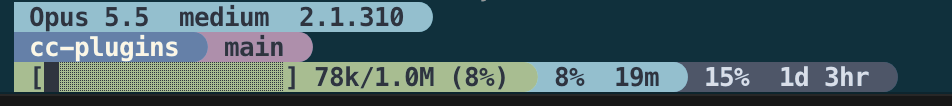
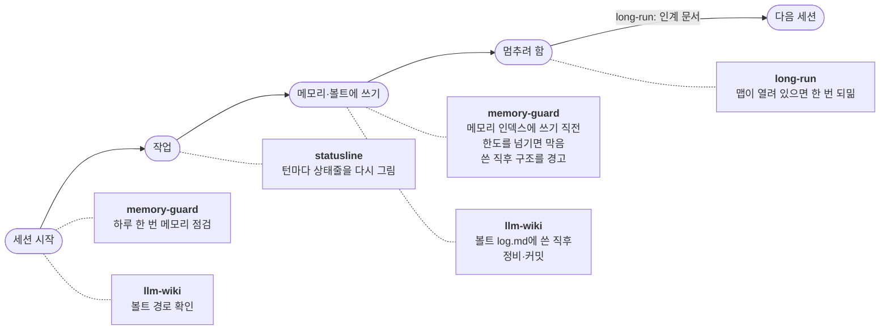
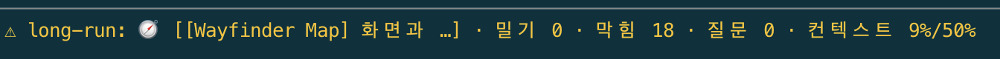

# cc-plugins

[Claude Code](https://code.claude.com/docs)(Anthropic의 AI 코딩 CLI)에 붙이는 플러그인 5종을 모은 개인 마켓플레이스.
npm 등 서드파티 패키지를 하나도 받지 않는다. 실행에는 `node`면 되고, long-run과 wf만 별도 CLI가 더 필요하다.

## 한눈에

| 플러그인 | 하는 일 | 이럴 때 쓴다 | 필요한 것 |
|---|---|---|---|
| [statusline](./plugins/statusline) | 프롬프트 아래에 모델·git·컨텍스트·사용량을 띄운다 | 남은 컨텍스트와 사용량을 늘 보고 싶을 때 | Claude Code v2.1.287+ |
| [memory-guard](./plugins/memory-guard) | 세션마다 로드되는 메모리가 비대해지고 낡는 것을 막는다 | 메모리가 잘려서 지식이 사라질 때 | 없음 |
| [llm-wiki](./plugins/llm-wiki) | 조사한 내용을 [Obsidian](https://obsidian.md) 노트 폴더(볼트)에 쌓고 다시 찾는다 | 조사한 것을 다음 작업에서 다시 쓰고 싶을 때 | Obsidian 볼트 |
| [long-run](./plugins/long-run) | 며칠 걸리는 작업을 세션이 바뀌어도, 여러 워커로 나눠서도 끝까지 민다 | 세션이 «다음으로 갈까요?»에서 멈출 때 | [bd](https://github.com/steveyegge/beads)(CLI 이슈 트래커), [orca](https://www.onorca.dev/)(Claude 세션을 worktree·터미널 탭으로 띄우는 도구) |
| [wf](./plugins/wf) | 작업 흐름을 설명하면 그에 맞는 워크플로우 플러그인을 설계한다 | 같은 진행 방식을 매번 처음부터 설명할 때 | `bd`, 플러그인 [long-run](./plugins/long-run)·[plugin-dev](https://github.com/anthropics/claude-plugins-official/tree/main/plugins/plugin-dev)·[beads](https://github.com/steveyegge/beads) |

설정 없이 바로 붙는 것은 위의 둘(statusline, memory-guard)이다.



statusline이 그린 상태줄. 1줄은 모델·노력 수준·버전, 2줄은 레포·브랜치, 3줄은 컨텍스트와 사용량이다.

## 주요 설계 결정

- **설계를 끝낸 검색 엔진을 구현 직전에 버렸다.** 설치 없이 어느 기기에서나 돌아야 해서, BM25 + 벡터 + rerank
  하이브리드 대신 내장 Grep 전수검색으로 갔다. 나중에 118문항으로 다시 평가해 보니 MRR 0.955로, 버린 스택(0.868,
  보정판 0.934)보다 낮지 않았다. 평가셋이 달라 소수점 비교는 하지 않는다.
  → [평가 기록](./docs/research/2026-08-17-recall-grep-eval.md) · [버린 설계](./docs/plans/archived/2026-07-25-llm-wiki-search-design.md)
- **막는 검사와 알리는 검사를 갈랐다.** 크기처럼 하드캡에 직결된 것만 막고, 추론이 들어가는 판정은 알림에 그친다.
  잘못 울린 알림은 무시하면 되지만, 잘못 막으면 세션이 풀 수 없게 갇힌다. → [memory-guard](./plugins/memory-guard)
- **상태줄 자리를 실측으로 정했다.** 상태줄용으로 보이는 `$.ui.status`는 실제로는 색도 줄바꿈도 안 되는
  알림 한 줄이었다. 그릴 자리도, 대응 값이 없어 보이던 위젯도 작은 mod로 하나씩 찍어 보고 정했다. → [statusline](./plugins/statusline)

접은 설계는 지우지 않고 [`docs/plans/archived/`](./docs/plans/archived/)에 이유와 함께 남긴다.

## Claude Code 확장점

플러그인은 Claude Code의 확장점 네 가지에 붙는다.

| 확장점 | 무엇인가 | 쓰는 플러그인 |
|---|---|---|
| 커맨드 | 사용자가 `/이름`으로 부른다 | llm-wiki |
| 스킬 | 작업 맥락이 맞으면 Claude가 읽는 지시문(`SKILL.md`) | llm-wiki · long-run · wf |
| 설정 훅 | 세션 이벤트(시작, 도구 호출 전후, 멈춤 등)에 셸 명령을 실행한다 | llm-wiki · memory-guard · long-run |
| [mod](https://code.claude.com/docs/en/plugins/mods/overview) | Claude Code 프로세스 안에서 도는 JavaScript 이벤트 핸들러. 화면에 직접 그리고 이벤트를 바꿀 수 있다 | statusline · long-run |

세션 하나가 흐르는 동안 각 플러그인은 서로 다른 시점에 끼어든다.



wf는 세션 안에 끼어들지 않는다. wf가 설계해 만든 플러그인이 같은 방식으로 파일 쓰기 직후와 `bd close` 직전에 끼어든다.

## 플러그인

### [statusline](./plugins/statusline) · v0.1.1
**mod로 그리는 상태줄.** 외부 도구 없이 프롬프트 아래에 모델·git·컨텍스트·사용량을 띄운다.

[ccstatusline](https://github.com/sirmalloc/ccstatusline)처럼 `statusLine` 설정으로 도는 상태줄은 다시 그릴 때마다
명령을 통째로 실행해 프로세스를 하나씩 띄운다. mod는 컨텍스트와 5시간·주간 사용량을 Claude Code에서 이벤트로 받으므로
네트워크 호출이 없고, 프로세스는 git처럼 Claude Code 밖의 값이 필요할 때만 띄운다. 켜진 위젯이 요구하는 것만 모은다.

- ccstatusline과 같은 모양으로 그리고, 위젯 id를 그대로 받아 설정을 `/sl import` 한 번에 옮긴다
- 끝까지 구현하지 못한 위젯은 Vim 실시간 모드 하나다. mod가 읽을 값이 없다

### [memory-guard](./plugins/memory-guard) · v0.6.1
**세션 메모리가 비대해지고 낡는 것을 막는다.** 인덱스를 키우는 쓰기를 막고, 메모리를 쓴 직후 구조를 경고하고, 하루 한 번 점검한다.

메모리는 세션마다 통째로 로드된다. 많이 담으면 작업에 쓸 컨텍스트를 잠식하고, Claude Code가 읽어 들이는 상한을
넘으면 뒷부분이 잘려 그 세션에는 없는 지식이 된다.

- 기본 한도는 그 상한(하드캡)에서 유도하되, Claude Code가 압축을 권하기 시작하는 선(하드캡의 0.8)은 어떤 설정으로도 넘지 않는다. 실사용 줄 길이가 달라 비율 하나로는 한 축이 허수가 되면 바이트·줄·항목 상한을 절대값으로 준다
- 항목 상한은 글자가 아니라 바이트로 잰다. 한글은 UTF-8에서 3바이트라 «250자» 같은 상한은 크기 캡보다 늘 늦게 걸려 한 번도 작동하지 않는다
- 커진 토픽 파일은 쪼개지 말고 합치라고 안내한다. Claude Code가 메모리를 골라 읽을 때 파일 앞 4KB만 보여 주므로 뒷조각은 거의 찾히지 않는다

### [llm-wiki](./plugins/llm-wiki) · v0.33.0
**[Obsidian](https://obsidian.md) 볼트를 지식 베이스로 운영한다.** 조사한 것을 쌓아 두고, 다음 작업에서 다시 찾고, 쌓인 것끼리 잇는다.

검색은 내장 Grep 전수검색으로 한다. 볼트 8.5MB를 훑는 데 0.02초였다. 포기한 시맨틱 유사도는 한국어 표기 변형을
쿼리 확장 규칙으로 메웠다(위 [주요 설계 결정](#주요-설계-결정) 참고).

- 캡처는 사용자가 부르지만(커맨드), 적재 규칙은 볼트에 쓸 때마다 적용되고(스킬), 정비와 커밋은 자동으로 돈다(설정 훅). 그래서 확장점 셋을 다 쓴다
- 볼트의 규칙은 플러그인이 아니라 볼트 루트의 `SCHEMA.md`가 갖는다

### [long-run](./plugins/long-run) · v0.11.2
**여러 세션에 걸치는 작업을 끝까지 민다.** 목표를 맵([bd](https://github.com/steveyegge/beads)의 epic)으로 세우고, 맵이 열린 채 멈추려는 세션을 한 번 되민다.



막으려는 멈춤은 셋이다. 한 덩이를 끝내고 «다음으로 갈까요?»로 돌아오는 것, 컨텍스트가 차서 흐지부지되는 것,
다음 세션이 어디까지 됐는지 모르고 다시 시작하는 것.

스킬은 한 세션 안에서만 살아서 이 문제를 못 푼다. 그래서 세션 밖에 남는 세 가지로 나눴다.

| 역할 | 무엇으로 | 세션이 끝나도 남는 이유 |
|---|---|---|
| 목표와 남은 티켓 | `bd`의 epic | DB에 있다 |
| 멈춤 막기 | mod (안 뜨는 환경에서는 설정 훅) | 플러그인에 달려 있어 어느 worktree에서 연 세션에도 붙는다 |
| 다음 세션으로 넘기기 | 인계 문서 | 파일로 남는다 |

- 맵을 선언하지 않은 세션은 건드리지 않고, 이미 한 번 되민 세션은 통과시킨다. 두 번 막으면 세션이 끝나지 않는다
- 같은 worktree에서도 맵을 맡은(claim한) 주인 세션 하나만 되민다. 같은 자리에서 다른 일로 연 세션은 건드리지 않는다
- 다음 세션으로 넘길 시점은 컨텍스트 비율이 아니라 이 세션이 닫은 티켓 수(2건)로 정한다. 비율은 계측에 실패하면 0%로 떨어지는데, 그걸 여유로 읽고 한 세션이 티켓 열 개를 닫은 적이 있다. 한 세션이 여러 티켓을 닫는 게 정상인 맵(코디네이터)은 `claim --no-ticket-limit`으로 이 축을 끄고 컨텍스트만 본다
- 방향을 바꾸는 질문을 만나면 멈추지 않고 질문을 티켓으로 남긴 뒤, 그 질문과 무관한 티켓을 계속 진행한다
- 남은 티켓이 0개여도 바로 끝내지 않는다. 다 한 것인지 티켓을 안 만든 것인지 모르므로, 새 컨텍스트의 서브에이전트가 완료 조건을 검증한 뒤에 맵을 닫는다
- 세션은 [orca](https://www.onorca.dev/) 탭으로 넘긴다
- 밀 수 있는 티켓이 여럿이면 병렬 웨이브로 나눠 돌릴 수 있다. base worktree의 코디네이터가 사용자가 승인한 폭·티켓 목록대로 orca 하위 worktree 워커에 티켓을 하나씩 넘기고(`wave.mjs start`), 워커는 bd를 쓰지 않는다. 결과는 코디네이터가 검증한 뒤 base에 순차 병합하고 worktree를 정리한다(`wave.mjs settle`). 병합과 bd 갱신을 한 곳에서만 하므로 워커끼리 DB를 두고 다투지 않는다

### [wf](./plugins/wf) · v0.8.0
**작업 흐름을 설명하면 그에 맞는 워크플로우 플러그인을 설계한다.**

분석 → 손대기 전 화면 촬영(as-is) → TDD 구현 → 바뀐 화면 촬영(to-be) → PR·이슈에 증거 게시 같은 흐름에서,
프로젝트에 묶인 부분(문서 도구, 스택, 게시처)을 걷어낸 뼈대다. 단계 이름도 고정하지 않고 `wf:design`이 설명을 듣고 도출한다.

- 정의 단계에서 빠진 항목은 결과물이 나온 뒤에야 드러난다. 그래서 정의 단계에 「무엇을 정의해야 하는가」의 목록(축)을 두고, 답하지 않은 축이 있으면 티켓을 닫지 못하게 한다
- 검사는 훅으로 건다. 생성된 플러그인은 문서를 쓴 직후 인용한 경로가 실재하는지 확인하고, `bd close` 직전에 축 누락을 막는다
- 축은 스킬 본문이 아니라 스펙 파일의 데이터라서, 회고가 축을 늘리면 플러그인을 다시 만들지 않아도 다음 실행부터 반영된다

## 설치

```bash
/plugin marketplace add aydenden/cc-plugins   # 등록 후 /plugin 에서 개별 선택
```

플러그인 하나만 바로 써보려면:

```bash
git clone https://github.com/aydenden/cc-plugins.git
claude --plugin-dir ./cc-plugins/plugins/statusline
```

전제 조건과 설정은 각 플러그인 README에 있다.

## 라이선스

MIT
